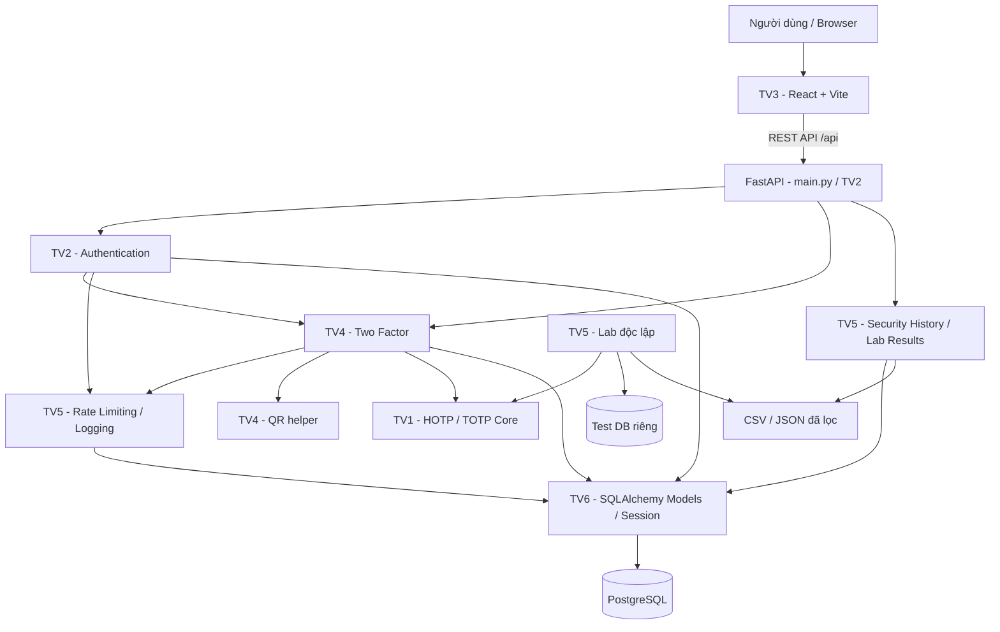
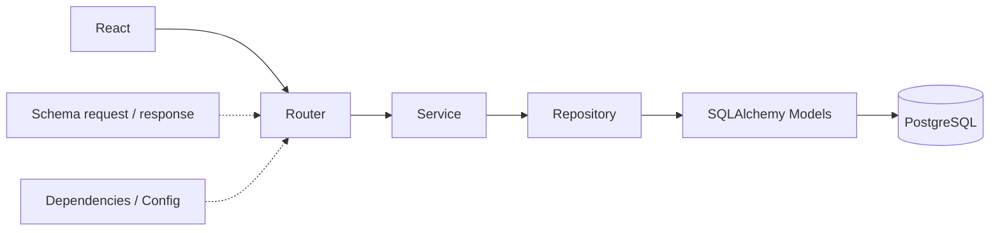
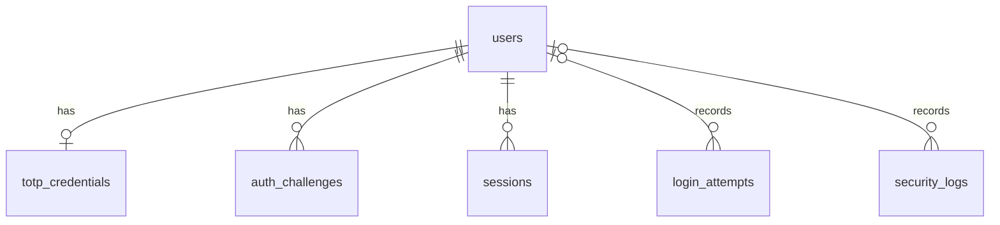
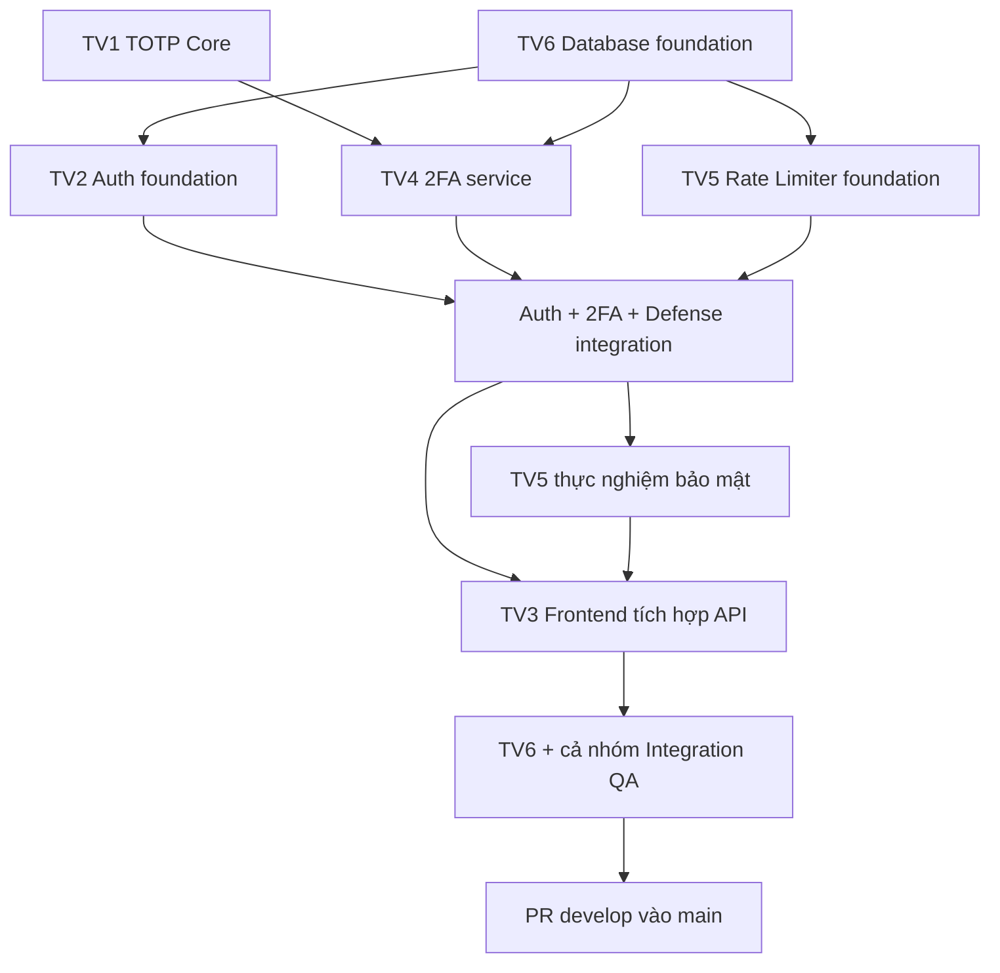

# SecureAuth-TOTP — Kiến trúc thư mục tổng thể

**Đề tài ĐT16:** Xác thực hai yếu tố bằng TOTP — An toàn thông tin  
**Repository:** [secureauth-totp](https://github.com/baonguyenmh2021-cpu/secureauth-totp)  
**Phiên bản tài liệu:** V3 — Master Project Structure  
**Ngày cập nhật:** 28/11/2026

> Tài liệu này là bản đồ kiến trúc đích để cả 6 thành viên phát triển song song và tích hợp. Tổng hợp từ 6 tài liệu phân công cá nhân V3 và cây thư mục đã trao đổi. Không phải danh sách file/branch đã được kiểm chứng trên GitHub. Các quyết định kỹ thuật mới phải được nhóm duyệt trước khi áp dụng. Nếu hợp đồng cũ mâu thuẫn với phần A–F trong tài liệu V3, ưu tiên hợp đồng V3 sau khi được duyệt. Không tạo hàng loạt file rỗng chỉ để khớp cây thư mục.

## Mục lục

1. [Phân công thành viên](#1-phân-công-thành-viên)
2. [Cấu trúc thư mục FULL](#2-cấu-trúc-thư-mục-full)
3. [Kiến trúc và luồng liên kết](#3-kiến-trúc-và-luồng-liên-kết)
4. [Trách nhiệm và hợp đồng module](#4-trách-nhiệm-và-hợp-đồng-module)
5. [Database và API](#5-database-và-api)
6. [Quyết định kỹ thuật dùng chung](#6-quyết-định-kỹ-thuật-dùng-chung)
7. [Git và quy trình tích hợp](#7-git-và-quy-trình-tích-hợp)
8. [Chạy dự án và kiểm thử](#8-chạy-dự-án-và-kiểm-thử)
9. [Checklist nghiệm thu](#9-checklist-nghiệm-thu)

## 1. Phân công thành viên

| TV | Họ và tên | Vai trò | Nhánh chức năng dự kiến |
|---|---|---|---|
| TV1 | Trần Quốc Trường | TOTP Core Developer | `feature/totp-core` |
| TV2 | Trần Thị Bảo Nguyên | Backend Authentication Developer | `feature/auth-backend` |
| TV3 | Giao Giao | Frontend Developer | `feature/frontend` |
| TV4 | Thanh Việt | 2FA & QR Integration Developer | `feature/2fa-integration` |
| TV5 | Đăng Nhật Thanh | Security Lab & Security Testing Developer | `feature/security-lab` |
| TV6 | Trúc | Database, Integration & QA Developer | `feature/database-setup` |

Kiến trúc: **Monorepo + Modular Monolith + Layered Architecture**. Một repository chung; Backend FastAPI chạy như một ứng dụng, chia theo module nghiệp vụ; Frontend React độc lập; PostgreSQL lưu trữ dữ liệu. Không chia thành microservices hoặc sáu repository riêng.

## 2. Cấu trúc thư mục FULL

Quy ước:

- `# TVn`: người chịu trách nhiệm chính; các file con kế thừa owner nếu không ghi khác.
- `(*)`: tên file/thư mục chi tiết đề xuất thêm để hoàn thiện hoặc mở rộng; không bắt buộc tạo ngay.
- `[local]`: chỉ có trên máy cá nhân hoặc sinh trong lúc build, không commit.
- Các file `.tsx`/`.ts` minh họa phương án TypeScript. Nếu project đã dùng JavaScript, giữ `.jsx`/`.js` tương ứng; không khởi tạo lại Vite. Các component, file CSS, hook và type cụ thể bên dưới là gợi ý triển khai của TV3.

```text
secureauth-totp/
│
├── backend/
│   ├── app/
│   │   ├── __init__.py
│   │   ├── main.py                          # TV2; TV6 review, đăng ký router chung
│   │   │
│   │   ├── core/
│   │   │   ├── __init__.py
│   │   │   ├── config.py                    # TV6: cấu hình môi trường
│   │   │   ├── security.py                  # TV2: hash/verify password
│   │   │   └── dependencies.py              # TV2: kiểm tra phiên, current_user
│   │   │
│   │   ├── database/                        # TV6 – Trúc
│   │   │   ├── __init__.py
│   │   │   ├── base.py                      # Declarative Base
│   │   │   ├── connection.py                # Engine, connection pool
│   │   │   ├── session.py                   # Session theo request
│   │   │   └── models/
│   │   │       ├── __init__.py              # Import models cho metadata
│   │   │       ├── user.py
│   │   │       ├── totp_credential.py
│   │   │       ├── auth_challenge.py
│   │   │       ├── login_attempt.py
│   │   │       ├── security_log.py
│   │   │       ├── session.py               # Model phiên, khác database/session.py
│   │   │       └── rate_limit_state.py      # Model trạng thái giới hạn
│   │   │
│   │   └── modules/
│   │       ├── __init__.py
│   │       │
│   │       ├── totp/                        # TV1 – Trần Quốc Trường
│   │       │   ├── __init__.py              # Public exports
│   │       │   ├── hotp.py                  # HMAC, dynamic truncation, HOTP
│   │       │   └── totp.py                  # generate_totp, match_totp_step
│   │       │
│   │       ├── auth/                        # TV2 – Trần Thị Bảo Nguyên
│   │       │   ├── __init__.py
│   │       │   ├── router.py                # Register, Login, Verify OTP, Me, Logout
│   │       │   ├── service.py               # Điều phối nghiệp vụ
│   │       │   ├── schemas.py               # Request/response
│   │       │   ├── repository.py            # Truy vấn dữ liệu xác thực
│   │       │   ├── session_service.py       # Tạo, kiểm tra, thu hồi phiên
│   │       │   └── challenge_service.py     # OTP Challenge, TTL, consume
│   │       │
│   │       ├── qrcode/                      # TV4 – Thanh Việt
│   │       │   ├── __init__.py
│   │       │   ├── uri_builder.py           # OTPAuth URI
│   │       │   └── qr_generator.py          # PNG QR trong bộ nhớ
│   │       │
│   │       ├── two_factor/                  # TV4 – Thanh Việt
│   │       │   ├── __init__.py
│   │       │   ├── router.py                # API quản lý 2FA
│   │       │   ├── service.py               # Setup, Enable, Verify, Cancel, Disable
│   │       │   ├── schemas.py
│   │       │   ├── repository.py            # Credential persistence
│   │       │   ├── secret_manager.py        # Sinh và decode Base32
│   │       │   ├── encryption.py            # Fernet encrypt/decrypt
│   │       │   └── replay_protection.py     # Consume matched step nguyên tử
│   │       │
│   │       └── security_lab/                # TV5 – Đăng Nhật Thanh
│   │           ├── __init__.py
│   │           ├── router.py                # API lịch sử, thống kê, kết quả lab
│   │           ├── service.py
│   │           ├── schemas.py
│   │           ├── repository.py
│   │           ├── defenses/                # Dùng trong nghiệp vụ thật
│   │           │   ├── __init__.py
│   │           │   ├── rate_limiter.py
│   │           │   └── security_logger.py
│   │           ├── experiments/             # Chỉ chạy lab/test cô lập
│   │           │   ├── __init__.py
│   │           │   ├── otp_guessing_simulation.py
│   │           │   ├── clock_drift_experiment.py
│   │           │   └── replay_experiment.py
│   │           └── analysis/
│   │               ├── __init__.py
│   │               ├── metrics.py
│   │               └── result_exporter.py
│   │
│   ├── alembic/                             # TV6, sau khi duyệt Alembic
│   │   ├── versions/                        # Revision do TV6 quản lý
│   │   ├── env.py
│   │   ├── script.py.mako
│   │   └── README
│   │
│   ├── tests/
│   │   ├── __init__.py
│   │   ├── conftest.py                      # TV6 (*) fixture chung
│   │   │
│   │   │   # TV1 – TOTP Core
│   │   ├── test_hotp.py
│   │   ├── test_totp.py
│   │   ├── test_totp_verify.py
│   │   │
│   │   │   # TV2 – Authentication
│   │   ├── test_password.py
│   │   ├── test_auth_register.py
│   │   ├── test_auth_login.py
│   │   ├── test_auth_session.py
│   │   ├── test_auth_challenge.py
│   │   │
│   │   │   # TV4 – 2FA & QR
│   │   ├── test_secret_manager.py
│   │   ├── test_secret_encryption.py
│   │   ├── test_otpauth_uri.py
│   │   ├── test_qr_generator.py
│   │   ├── test_two_factor_setup.py
│   │   ├── test_two_factor_verify.py
│   │   ├── test_otp_replay.py
│   │   │
│   │   │   # TV5 – Security Testing
│   │   ├── test_rate_limiter.py
│   │   ├── test_clock_drift.py
│   │   ├── test_replay_security.py
│   │   ├── test_security_logging.py
│   │   ├── test_auth_security.py
│   │   │
│   │   └── integration/                     # TV6, tên file cụ thể đề xuất (*)
│   │       ├── __init__.py
│   │       ├── conftest.py
│   │       ├── test_database.py
│   │       ├── test_migration.py
│   │       ├── test_auth_flow.py
│   │       ├── test_two_factor_flow.py
│   │       ├── test_security_flow.py
│   │       ├── test_concurrency.py
│   │       └── test_full_workflow.py
│   │
│   ├── .venv/                               # [local]
│   ├── .env                                 # [local]
│   ├── .env.example                         # TV6
│   ├── alembic.ini                          # TV6
│   ├── pytest.ini                           # TV6 (*)
│   └── requirements.txt                     # TV6 quản lý dependency chung
│
├── frontend/                                # TV3 – Giao Giao
│   ├── public/
│   │   └── favicon.svg                      # (*)
│   ├── src/
│   │   ├── assets/
│   │   │   ├── images/
│   │   │   ├── icons/
│   │   │   └── logo.svg                     # (*)
│   │   ├── components/
│   │   │   ├── common/
│   │   │   │   ├── LoadingSpinner.tsx
│   │   │   │   ├── ErrorMessage.tsx
│   │   │   │   ├── EmptyState.tsx
│   │   │   │   └── ConfirmDialog.tsx
│   │   │   ├── auth/
│   │   │   │   ├── LoginForm.tsx
│   │   │   │   ├── RegisterForm.tsx
│   │   │   │   ├── PasswordInput.tsx
│   │   │   │   └── OTPInput.tsx
│   │   │   ├── security/
│   │   │   │   ├── QRCodeDisplay.tsx
│   │   │   │   ├── TwoFactorStatus.tsx
│   │   │   │   └── SecurityEventTable.tsx
│   │   │   └── charts/
│   │   │       ├── LoginActivityChart.tsx
│   │   │       ├── RateLimitChart.tsx
│   │   │       └── ClockDriftChart.tsx
│   │   ├── layouts/
│   │   │   ├── AuthLayout.tsx
│   │   │   └── DashboardLayout.tsx
│   │   ├── pages/
│   │   │   ├── Login/
│   │   │   │   ├── LoginPage.tsx
│   │   │   │   └── LoginPage.module.css
│   │   │   ├── Register/
│   │   │   │   ├── RegisterPage.tsx
│   │   │   │   └── RegisterPage.module.css
│   │   │   ├── VerifyOTP/
│   │   │   │   ├── VerifyOTPPage.tsx
│   │   │   │   └── VerifyOTPPage.module.css
│   │   │   ├── TwoFactorSetup/
│   │   │   │   ├── TwoFactorSetupPage.tsx
│   │   │   │   └── TwoFactorSetupPage.module.css
│   │   │   ├── SecuritySettings/
│   │   │   │   ├── SecuritySettingsPage.tsx
│   │   │   │   └── SecuritySettingsPage.module.css
│   │   │   ├── Dashboard/
│   │   │   │   ├── DashboardPage.tsx
│   │   │   │   └── DashboardPage.module.css
│   │   │   ├── LoginHistory/
│   │   │   │   ├── LoginHistoryPage.tsx
│   │   │   │   └── LoginHistoryPage.module.css
│   │   │   ├── SecurityLab/
│   │   │   │   ├── SecurityLabPage.tsx
│   │   │   │   └── SecurityLabPage.module.css
│   │   │   └── NotFound/
│   │   │       └── NotFoundPage.tsx
│   │   ├── services/
│   │   │   ├── apiClient.ts
│   │   │   ├── authApi.ts
│   │   │   ├── totpApi.ts
│   │   │   └── securityApi.ts
│   │   ├── contexts/
│   │   │   └── AuthContext.tsx
│   │   ├── hooks/
│   │   │   ├── useAuth.ts
│   │   │   └── useCountdown.ts
│   │   ├── routes/
│   │   │   └── ProtectedRoute.tsx
│   │   ├── types/                           # Chỉ khi dùng TypeScript
│   │   │   ├── auth.types.ts
│   │   │   ├── totp.types.ts
│   │   │   └── security.types.ts
│   │   ├── mocks/                           # Chỉ dev/test độc lập
│   │   │   ├── auth.mock.ts
│   │   │   ├── totp.mock.ts
│   │   │   └── security.mock.ts
│   │   ├── tests/
│   │   │   ├── LoginPage.test.tsx
│   │   │   ├── RegisterPage.test.tsx
│   │   │   ├── VerifyOTPPage.test.tsx
│   │   │   ├── TwoFactorSetupPage.test.tsx
│   │   │   └── ProtectedRoute.test.tsx
│   │   ├── App.tsx
│   │   ├── main.tsx
│   │   └── index.css
│   ├── node_modules/                        # [local]
│   ├── dist/                                # [local] build output
│   ├── .env                                 # [local] nếu cần, không chứa secret
│   ├── .env.example
│   ├── .gitignore
│   ├── index.html
│   ├── package.json
│   ├── package-lock.json
│   ├── vite.config.ts                       # hoặc .js
│   ├── eslint.config.js
│   └── tsconfig.json                        # Chỉ khi dùng TypeScript
│
├── docs/
│   ├── theory/
│   │   ├── totp_core.md                     # TV1
│   │   └── totp_security.md                 # TV5
│   ├── architecture/
│   │   ├── system_architecture.md           # TV6 + cả nhóm (*)
│   │   ├── authentication_api.md            # TV2
│   │   ├── frontend.md                      # TV3
│   │   ├── two_factor_api.md                # TV4
│   │   ├── security_api.md                  # TV5 (*)
│   │   └── integration.md                   # TV6
│   ├── database/                            # TV6
│   │   ├── erd.png
│   │   ├── erd.dbml                         # (*) nguồn chỉnh sửa
│   │   └── data_dictionary.md
│   ├── experiments/                         # TV5
│   │   └── security_lab_report.md
│   ├── diagrams/                            # Cả nhóm (*)
│   │   ├── use_case.png
│   │   ├── system_architecture.png
│   │   ├── authentication_flow.png
│   │   ├── two_factor_setup_flow.png
│   │   ├── totp_algorithm_flow.png
│   │   ├── rate_limiting_flow.png
│   │   └── git_workflow.png
│   └── guides/                              # Tài liệu chung (*)
│       ├── installation.md
│       ├── git_workflow.md
│       ├── technical_decisions.md
│       ├── api_contract.md
│       ├── testing_guide.md
│       └── demo_guide.md
│
├── data/
│   ├── test_vectors/                        # TV1 (*) chỉ vector RFC công khai
│   │   ├── rfc4226_vectors.json
│   │   └── rfc6238_vectors.json
│   └── experiments/                         # TV5: kết quả thử nghiệm đã lọc
│       ├── rate_limit_results.csv
│       ├── clock_drift_results.csv
│       ├── replay_results.csv
│       └── experiment_summary.json
│
├── evidence/                                # Chỉ minh chứng đã loại dữ liệu nhạy cảm
│   ├── totp_vectors/                        # TV1
│   │   ├── rfc4226_test_results.txt
│   │   └── rfc6238_test_results.txt
│   ├── authentication/                      # TV2 (*)
│   │   ├── swagger/
│   │   └── test_results/
│   ├── frontend/                            # TV3
│   │   ├── screenshots/
│   │   └── test_results/
│   ├── two_factor/                          # TV4
│   │   ├── authenticator/
│   │   ├── qr_setup/
│   │   └── test_results/
│   ├── security_lab/                        # TV5
│   │   ├── rate_limiting/
│   │   ├── clock_drift/
│   │   ├── replay/
│   │   └── charts/
│   └── integration/                         # TV6
│       ├── database/
│       ├── integration_tests/
│       └── final_demo/
│
├── .github/                                 # Trưởng nhóm + TV6 (*)
│   ├── workflows/
│   │   ├── backend-ci.yml
│   │   └── frontend-ci.yml
│   ├── ISSUE_TEMPLATE/
│   │   └── bug_report.md
│   └── PULL_REQUEST_TEMPLATE.md
│
├── .gitignore                               # Trưởng nhóm
├── README.md                                # Hướng dẫn cài đặt và chạy
├── PROJECT_STRUCTURE.md                     # Bản đồ này, trưởng nhóm + TV6
└── CHANGELOG.md                             # (*) lịch sử phiên bản
```

## 3. Kiến trúc và luồng liên kết

### 3.1. Sơ đồ hệ thống



TOTP Core không phụ thuộc FastAPI hoặc Database. QR helper không tự cấp phiên. Lab không được điều khiển bảo mật hệ thống chính; chỉ dùng dữ liệu tổng hợp và tài khoản thử nghiệm trong môi trường riêng.

### 3.2. Kiến trúc Backend theo tầng



| Thành phần | Trách nhiệm |
|---|---|
| `router.py` | Nhận request, validate bằng schema/dependency, gọi service, trả HTTP response. |
| `schemas.py` | Định nghĩa dữ liệu vào/ra; không trả password hash, token digest hay secret. |
| `service.py` | Điều phối nghiệp vụ, xử lý trạng thái và ranh giới transaction. |
| `repository.py` | Truy vấn/cập nhật DB bằng session được truyền vào; không tự commit rời rạc. |
| `database/models/` | Model, PK/FK, unique, constraints, index. |
| `main.py` | Khởi tạo app và đăng ký các router; một nơi quản lý để tránh trùng endpoint. |
| `core/config.py` | Đọc biến môi trường; không đưa bí mật vào source code. |
| `core/dependencies.py` | Xác thực phiên đầy đủ cho API bảo vệ. |

### 3.3. Luồng đăng nhập với 2FA

```mermaid
sequenceDiagram
    actor U as User
    participant FE as TV3 Frontend
    participant A as TV2 Auth
    participant L as TV5 Limiter
    participant M as TV4 2FA
    participant T as TV1 TOTP
    participant D as TV6 DB
    U->>FE: Email + password
    FE->>A: POST /api/auth/login
    A->>L: Kiểm soát lượt xác thực password
    A->>D: Đọc user và trạng thái 2FA
    Note over A: Kiểm tra password, không cấp phiên nếu 2FA đang bật
    A->>D: Tạo challenge có TTL
    A-->>FE: OTP_REQUIRED + challenge_id
    U->>FE: Nhập OTP từ Authenticator
    FE->>A: POST /api/auth/verify-otp
    A->>L: Kiểm soát lượt OTP
    A->>M: Kiểm tra nghiệp vụ 2FA
    M->>D: Lấy credential đã mã hóa
    M->>T: match_totp_step(secret, otp)
    T-->>M: matched_step hoặc None
    Note over A,D: Kiểm tra lại trạng thái; consume step + challenge + tạo session nguyên tử
    A->>D: Commit giao dịch nếu hợp lệ
    A-->>FE: AUTHENTICATED + cookie
    FE->>A: GET /api/auth/me
    A-->>FE: Thông tin người dùng
    FE-->>U: Dashboard
```

Sơ đồ mô tả nhánh thành công khi 2FA bật. Lỗi, rollback, logging và trường hợp 2FA tắt được giản lược. Không cấp cookie phiên đầy đủ khi OTP sai, challenge hết hạn, rate limit đang chặn hoặc DB không nhất quán. TV3 chỉ chuyển Dashboard sau khi Backend xác nhận; khi bật 2FA thành công, đăng nhập lại bằng OTP mới (mã vừa dùng để kích hoạt có thể bị replay protection từ chối).

## 4. Trách nhiệm và hợp đồng module

| TV | Đường dẫn chính | MVP phải bàn giao | Không tự làm thay người khác |
|---|---|---|---|
| TV1 | `backend/app/modules/totp/` | HOTP, TOTP, 10 vector RFC 4226 + 18 vector RFC 6238, verify | Không API, DB, QR |
| TV2 | `backend/app/modules/auth/`, `core/security.py`, `core/dependencies.py` | Register, Login, Challenge, Verify OTP API, Session, Logout, Me | Không viết lại TOTP hoặc QR |
| TV3 | `frontend/` | Login/Register, QR Setup, OTP, Dashboard, Lab cơ bản, API integration | Không xác minh OTP tại browser, không kết nối DB |
| TV4 | `backend/app/modules/qrcode/`, `two_factor/` | Secret, encryption, QR, setup/enable/status/cancel, verify/replay | Không cấp session; không trùng API verify-otp |
| TV5 | `backend/app/modules/security_lab/` | Rate limiting, clock drift, mô phỏng lab, security log, số liệu thực nghiệm | Không tắt phòng thủ ứng dụng chính; không thay nghiệp vụ TV2/TV4 |
| TV6 | `backend/app/database/`, `backend/alembic/`, `backend/tests/integration/` | DB foundation, schema/migration, fixture, kiểm thử tích hợp | Không sửa nghiệp vụ của tất cả TV thay cho owner |

### 4.1. Hợp đồng tích hợp quan trọng

- TV1 → TV4/TV5: `generate_hotp`, `generate_totp`, `match_totp_step`. Core nhận `secret: bytes`, OTP là `str`, thời gian có thể được truyền trong test. `match_totp_step()` trả `int` hoặc `None`; dùng `step is not None`, vì `0` là time-step hợp lệ. `verify_totp` (nếu có) chỉ là wrapper bool. Không dùng thư viện TOTP để thay thuật toán tự cài đặt.
- TV4 → TV2: service xác minh 2FA, giải mã credential và kiểm soát replay. TV2 sở hữu `/api/auth/verify-otp`, challenge và phiên. Hai module phối hợp TV6 bảo đảm consume step, challenge và tạo phiên nhất quán trong transaction thành công.
- TV5 → TV2/TV4: bộ giới hạn lượt thử và logging. Kiểm soát đồng thời phải nguyên tử; không chỉ đọc bộ đếm rồi tăng ở giao dịch riêng không khóa. Trạng thái PASSWORD và OTP độc lập; tạo challenge mới không được reset giới hạn. Lỗi xác thực phải được ghi nhận/lưu đúng, kể cả khi nghiệp vụ xác thực thất bại.
- TV6 → TV2/TV4/TV5: một Base chung, engine/session theo request, migration và test DB riêng. Module không tự sửa schema hoặc tự tạo bảng trùng.
- TV2/TV4/TV5 → TV3: API Contract, mã lỗi và dữ liệu thống kê. FE gọi đường dẫn tương đối `/api`, nhận cookie phiên từ Backend, không lưu password/secret/token vào localStorage.
- TV5 → TV3: kết quả CSV/JSON đo trong lab, phân biệt rõ dữ liệu minh họa và thực nghiệm; không có endpoint nhắm mục tiêu ngoài hoặc tắt phòng thủ hệ thống chính.

### 4.2. File dùng chung dễ conflict

| File/thư mục | Owner chính | Quy tắc |
|---|---|---|
| `backend/app/main.py` | TV2 | TV4/TV5 đề xuất đăng ký router; TV6 review. |
| `backend/app/core/config.py` | TV6 | Thống nhất biến môi trường với các TV Backend. |
| `backend/app/core/dependencies.py` | TV2 | TV4/TV5 sử dụng dependency xác thực. |
| `backend/requirements.txt` | TV6 | TV khác gửi đề xuất dependency; không xóa thư viện của nhau. |
| `backend/.env.example` | TV6 | Chỉ placeholder, không có giá trị bí mật thật. |
| `backend/alembic/`, `backend/alembic.ini` | TV6 | Review migration trước khi chạy, không tạo revision trùng. |
| `backend/tests/conftest.py` | TV6 | Nếu dùng fixture chung; test của mỗi module do owner viết. |
| `frontend/package.json`, `package-lock.json` | TV3 | Cập nhật đồng bộ dependency/lockfile. |
| `README.md`, `.gitignore`, `PROJECT_STRUCTURE.md`, `.github/` | Trưởng nhóm + TV6 hỗ trợ | Review thay đổi chung. |

## 5. Database và API

### 5.1. Database logic (7 bảng dự kiến)



`rate_limit_states` là bảng riêng: scope có thể theo tài khoản hoặc IP, không buộc mọi record có FK tới users. ERD trên là sơ đồ quan hệ logic rút gọn; FK, nullable và constraints cụ thể theo Data Dictionary TV6 V3 sau khi nhóm duyệt.

| Bảng | Model | Mục đích | Sử dụng |
|---|---|---|---|
| `users` | `user.py` | Tài khoản, password hash | TV2 |
| `totp_credentials` | `totp_credential.py` | Encrypted secret, enrollment, matched step đã dùng | TV4 |
| `auth_challenges` | `auth_challenge.py` | Challenge đăng nhập có thời hạn, trạng thái | TV2 |
| `sessions` | `session.py` | Digest của token phiên, expiry, revoke | TV2 |
| `login_attempts` | `login_attempt.py` | Lịch sử thử xác thực | TV2, TV5 |
| `security_logs` | `security_log.py` | Sự kiện bảo mật đã lọc | TV2, TV4, TV5 |
| `rate_limit_states` | `rate_limit_state.py` | Trạng thái bộ giới hạn bền vững | TV5 |

### 5.2. API Contract tổng quan

Các endpoint dưới đây sử dụng prefix `/api`. Các API quản lý tài khoản và lịch sử phải lấy user từ phiên hợp lệ, không tin user ID do browser tự gửi. TV2/TV4/TV5 bàn giao JSON contract chi tiết cho TV3.

| Method | Endpoint | Request chính | Response thành công | Owner |
|---|---|---|---|---|
| POST | `/api/auth/register` | username, email, password | 201: id, username, email | TV2 |
| POST | `/api/auth/login` | email, password | 200: AUTHENTICATED + cookie hoặc OTP_REQUIRED + challenge_id + expires_in | TV2 |
| POST | `/api/auth/verify-otp` | challenge_id, otp (chuỗi) | 200: AUTHENTICATED + cookie | TV2 gọi TV4 |
| GET | `/api/auth/me` | Phiên đầy đủ | 200: id, username, email, two_factor_enabled | TV2 |
| POST | `/api/auth/logout` | `{}` + phiên | 204: revoke và xóa cookie | TV2 |
| POST | `/api/2fa/setup` | password + phiên | 200: PENDING, qr_code, algorithm, digits, period, expires_in | TV4 |
| POST | `/api/2fa/enable` | otp + phiên | 200: ENABLED, reauth_required=true; thu hồi phiên | TV4 |
| GET | `/api/2fa/status` | Phiên | 200: enabled, status; không trả secret | TV4 |
| POST | `/api/2fa/cancel-setup` | `{}` + phiên | 200: DISABLED | TV4 |
| POST | `/api/2fa/disable` | password, otp + phiên | 200: DISABLED, reauth_required=true (mở rộng) | TV4 |
| GET | `/api/security/history` | Phiên; bộ lọc theo hợp đồng | Lịch sử của tài khoản | TV5 |
| GET | `/api/security/statistics` | Phiên | Thống kê tài khoản | TV5 |
| GET | `/api/security/rate-limit/status` | Phiên | Trạng thái giới hạn; endpoint đề xuất bổ sung | TV5 |
| GET | `/api/lab/results/rate-limit` | Theo chính sách truy cập lab | Kết quả đã lọc, chỉ đọc | TV5 |
| GET | `/api/lab/results/clock-drift` | Theo chính sách truy cập lab | Kết quả đã lọc, chỉ đọc | TV5 |
| GET | `/api/lab/results/replay` | Theo chính sách truy cập lab | Kết quả đã lọc, chỉ đọc | TV5 |

| HTTP | Error code V3 | Xử lý |
|---|---|---|
| 401 | INVALID_CREDENTIALS | Thông báo chung, không tiết lộ tài khoản tồn tại. |
| 401 | OTP_INVALID | OTP sai hoặc replay; log nội bộ phân biệt. |
| 401 | CHALLENGE_INVALID / SESSION_REQUIRED | Quay về đăng nhập. |
| 403 | CSRF_REJECTED / FORBIDDEN | Từ chối request không hợp lệ. |
| 409 | ACCOUNT_CONFLICT / STATE_CONFLICT / ENROLLMENT_EXPIRED | Thông báo phù hợp, thiết lập lại nếu cần. |
| 422 | VALIDATION_ERROR | Hiển thị lỗi input, không phản chiếu secret. |
| 429 | RATE_LIMITED | Đọc Retry-After và retry_after; không kiểm OTP lúc bị chặn. |
| 503 | SERVICE_UNAVAILABLE | Không cấp phiên; không trả stack trace. |

## 6. Quyết định kỹ thuật dùng chung

Baseline đề xuất V3, chờ trưởng nhóm và các TV liên quan xác nhận. Đây không phải xác nhận hệ thống đã triển khai hoặc chứng nhận an toàn.

| Mục | Phương án |
|---|---|
| Backend | Python 3.11 + FastAPI + Uvicorn |
| Frontend | React + Vite; giữ JS/TS hiện có |
| Database | PostgreSQL 18 + SQLAlchemy 2.x + psycopg 3; Alembic sau khi duyệt |
| Password | Argon2id (`pwdlib[argon2]`), 15–128 ký tự, không trim, cho Unicode/khoảng trắng |
| Email / username | Email trim + lowercase; username 3–50 ký tự ASCII chữ/số/_ và lowercase |
| Session | Server-side, token ngẫu nhiên; lưu digest; TTL tuyệt đối 8 giờ, revoke server-side |
| Cookie / CSRF | HttpOnly, SameSite phù hợp, Secure trên HTTPS; POST JSON + `X-CSRF-Guard: 1` + kiểm Origin đúng; không coi header cố định là secret |
| Secret | `secrets`, Base32, Fernet (cryptography); key cấu hình riêng DB |
| TOTP website | HMAC-SHA1, 6 chữ số, period 30s, T0=0, window ±1; Core mặc định window=0 |
| RFC tests | SHA1/256/512, 8 digits; đúng secret thử theo từng thuật toán |
| Challenge / Enrollment | 120s / 300s; trạng thái và consume được kiểm soát |
| Rate limiting | 5 lần sai trong 60s, chặn 60s từ lần sai thứ 5; tách PASSWORD và OTP |
| Local dev | Browser `http://localhost:5173`; Vite proxy `/api` tới `http://127.0.0.1:8000`; không gọi Backend trực tiếp từ React |
| Testing | pytest + httpx; FE test runner theo cấu hình đã duyệt; DB dev/test độc lập |
| Git | main → develop → feature branches; PR review trước merge |

Không thay đổi tên hàm, tham số, field JSON, status code hoặc schema nếu chưa thông báo cho các module phụ thuộc. Thay đổi được duyệt nên cập nhật đồng thời tài liệu chung, test và code.

## 7. Git và quy trình tích hợp

### 7.1. Các nhánh

```text
main                             # Phiên bản ổn định để demo
└── develop                      # Nhánh tích hợp
    ├── feature/totp-core         # TV1
    ├── feature/auth-backend      # TV2
    ├── feature/frontend          # TV3
    ├── feature/2fa-integration   # TV4
    ├── feature/security-lab      # TV5
    └── feature/database-setup    # TV6
```

TV6 có thể tách PR nền tảng, models, migration, integration test thành các nhánh nhỏ nếu cần. Sau khi PR được merge, tạo nhánh tiếp theo từ develop mới cho phần việc mới.

### 7.2. Trình tự tích hợp theo phụ thuộc



Đây là thứ tự bàn giao từng phần, không bắt buộc chờ mỗi người hoàn thành toàn bộ. Nếu auth import 2FA/limiter, merge các PR nền tảng của 2FA/limiter trước PR auth phụ thuộc. Mỗi PR phải có khả năng build/test trong phạm vi phù hợp; không merge module có import chưa tồn tại.

| Mốc đề xuất | Người bàn giao | Đầu ra |
|---|---|---|
| Ngày 1 | Cả nhóm | Duyệt baseline, quyền Git, phạm vi MVP |
| Ngày 2–4 | TV6; TV2, TV4 | Schema ngày 2, API ngày 3, DB foundation ngày 4 |
| Ngày 5–7 | TV1 | Core ngày 5, đủ RFC test ngày 7 |
| Ngày 8–10 | TV5, TV2 | Limiter ngày 8, Auth ngày 10 |
| Ngày 12–13 | TV4, TV5 | QR/2FA ngày 12, kết quả lab ngày 13 |
| Ngày 14–15 | TV3, TV6 và cả nhóm | UI tích hợp ngày 14, QA/demo ngày 15 |

Mốc tính theo ngày làm việc của kế hoạch, không phải ngày lịch hoặc tình trạng đã hoàn thành.

### 7.3. Thành viên chuẩn bị PR (PowerShell)

Tại thư mục gốc repository, lưu và commit công việc đang làm trước khi chuyển/merge branch. Thay `feature/totp-core` bằng nhánh đúng của mình.

```powershell
git status
git switch feature/totp-core
git fetch origin
git merge origin/develop
```

Nếu có conflict: mở các file xung đột, trao đổi owner, giữ logic hợp lệ của cả hai bên, stage các file đã giải quyết và hoàn tất merge. Nếu cần hủy merge đang dở, dùng `git merge --abort` khi phù hợp. Sau khi test lại:

```powershell
git status
git push -u origin feature/totp-core
```

Tạo PR trên GitHub: **base = develop**, **compare = branch cá nhân**. Mô tả nhiệm vụ, danh sách file, test đã chạy, kết quả, blocker và người review. Không tự merge vào main. Không `push --force` hoặc `reset --hard` tùy tiện.

### 7.4. Trưởng nhóm review và merge

1. Kiểm tra nhánh, phạm vi thay đổi, commit và bí mật có thể bị lộ.
2. Kiểm tra contract/schema và dependency; yêu cầu sửa nếu chưa đạt.
3. Xem Checks nếu có CI; không có CI thì chạy test thủ công.
4. Merge PR vào develop khi đạt yêu cầu. Ưu tiên merge commit nếu muốn giữ lịch sử commit từng thành viên.
5. Cập nhật local develop, chạy test sau merge rồi mới xử lý PR tiếp theo.
6. Chỉ tạo PR `develop` → `main` sau khi nghiệm thu toàn bộ MVP.

```powershell
git status
git switch develop
git pull --ff-only origin develop
git log --oneline --graph --all
```

## 8. Chạy dự án và kiểm thử

Các lệnh chỉ áp dụng khi các file và dependency tương ứng đã được tạo. Windows PowerShell dùng `.venv\Scripts\python.exe` và `npm.cmd` để tránh lỗi execution policy. Không khởi tạo lại frontend/migration nếu đã có.

### 8.1. Backend

```powershell
cd backend
py -3.11 -m venv .venv  # bỏ qua nếu venv đang hoạt động
.\.venv\Scripts\python.exe -m pip install -r requirements.txt
```

TV6 cung cấp `.env.example`, PostgreSQL dev/test riêng và migration. Mỗi người tạo `.env` cục bộ và thay placeholder theo cấu hình do TV6 hướng dẫn, không commit. Với Alembic đã cấu hình và URL đã kiểm tra đúng DB dev, chạy:

```powershell
.\.venv\Scripts\python.exe -m alembic upgrade head
.\.venv\Scripts\python.exe -m uvicorn app.main:app --reload
```

Swagger: `http://127.0.0.1:8000/docs`. Swagger/TestClient cũng phải đáp ứng chính sách request/Origin/CSRF đã thống nhất. Đối với test tích hợp, migration và fixture phải dùng `TEST_DATABASE_URL`, không dùng DB dev. Core TV1 chạy độc lập không cần PostgreSQL.

### 8.2. Frontend (terminal riêng tại thư mục gốc)

```powershell
cd frontend
npm.cmd ci             # nếu package-lock.json đồng bộ; nếu chưa có dùng npm.cmd install
npm.cmd run dev
```

Mở `http://localhost:5173/`; cấu hình Vite proxy `/api` trước khi tích hợp cookie session. Kiểm tra build:

```powershell
npm.cmd run build
```

### 8.3. Kiểm thử theo thành viên

Tại `backend/`, chạy các file hiện có của từng module:

| TV | Lệnh sau tiền tố `.\.venv\Scripts\python.exe -m pytest` |
|---|---|
| TV1 | `tests/test_hotp.py tests/test_totp.py tests/test_totp_verify.py -v` |
| TV2 | `tests/test_password.py tests/test_auth_register.py tests/test_auth_login.py tests/test_auth_session.py tests/test_auth_challenge.py -v` |
| TV4 | `tests/test_secret_manager.py tests/test_secret_encryption.py tests/test_otpauth_uri.py tests/test_qr_generator.py tests/test_two_factor_setup.py tests/test_two_factor_verify.py tests/test_otp_replay.py -v` |
| TV5 | `tests/test_rate_limiter.py tests/test_clock_drift.py tests/test_replay_security.py tests/test_security_logging.py tests/test_auth_security.py -v` |
| TV6 | `tests/integration/ -v` (sau khi xác minh test DB riêng) |

TV3 chạy script test đã cấu hình trong `package.json` và `npm.cmd run build`. TV6 chạy toàn bộ Backend test khi test DB an toàn và fixture đã sẵn sàng:

```powershell
.\.venv\Scripts\python.exe -m pytest -v
```

### 8.4. Quy tắc `.gitignore`

Gộp với `.gitignore` hiện có, không ghi đè tùy tiện:

```gitignore
# Python
__pycache__/
*.py[cod]
*.egg-info/
.venv/
venv/
.pytest_cache/
.coverage
htmlcov/

# Node / Vite
node_modules/
dist/
.vite/

# Environment
.env
.env.*
!.env.example

# IDE / OS
.vscode/
.idea/
.DS_Store
Thumbs.db

# Local logs / dumps / secrets
*.log
logs/
*.sqlite
*.sqlite3
*.dump
*.backup
secrets/
*.pem
*.key
```

Không commit QR chứa secret đang dùng, Fernet key, mật khẩu PostgreSQL, OTP hoặc token thật, DB dump nhạy cảm, log chưa lọc. `.gitignore` không xóa file đã tracked hoặc bí mật đã lộ trong lịch sử; nếu lộ secret cần thu hồi/đổi khóa và xử lý lịch sử theo quy trình của nhóm. Giữ `requirements.txt`, `package-lock.json`, migration và `.env.example` trong Git.

## 9. Checklist nghiệm thu

Các ô để trống vì chưa xác minh kết quả thực tế. Đánh dấu sau khi có PR, kết quả test và minh chứng.

| TV | Điều kiện nghiệm thu |
|---|---|
| TV1 | 10 HOTP + 18 TOTP vector; boundary, window, định dạng, step 0; tài liệu hàm. |
| TV2 | Register/login/logout/me; challenge dùng một lần, phiên hết hạn/revoke; không bypass 2FA. |
| TV3 | Login/Register/OTP/QR/Dashboard/Lab; xử lý lỗi; FE build; không mock trong bản demo thật. |
| TV4 | QR quét được bằng Authenticator, secret mã hóa, kích hoạt bằng OTP, replay bị từ chối. |
| TV5 | Giới hạn đồng thời, clock drift, kết quả trước/sau phòng thủ, log đã lọc, lab độc lập. |
| TV6 | Migration DB test sạch, FK/unique, transaction, concurrency, clean clone/run và full flow. |

- [ ] Cả nhóm duyệt quyết định kỹ thuật V3 và xác minh quyền truy cập repository.
- [ ] TV1 và TV6 bàn giao nền tảng; API Contract được TV2/TV4/TV5/TV3 thống nhất.
- [ ] PR của từng thành viên đã review; không có file bí mật hoặc thay đổi ngoài phạm vi không được duyệt.
- [ ] Backend tests và Frontend build đạt; migration và test DB được kiểm soát.
- [ ] Demo từ đăng ký → đăng nhập → thiết lập QR → kích hoạt 2FA → đăng nhập lại → OTP → Dashboard → logout.
- [ ] Kiểm thử OTP sai, hết hạn challenge, replay, rate limiting và quyền truy cập.
- [ ] Có số liệu thực nghiệm thật, ghi rõ điều kiện và không nhầm với số minh họa.
- [ ] README hướng dẫn clean clone/run và tài liệu kiến trúc phản ánh mã nguồn thực tế.
- [ ] PR `develop` vào `main` được nghiệm thu; phiên bản demo xác định được bằng commit/tag.

---

**Quản lý tài liệu:** Trưởng nhóm và TV6 cập nhật `PROJECT_STRUCTURE.md` khi có thay đổi kiến trúc đã duyệt. Các thành viên dùng tài liệu V3 riêng để xem hướng dẫn chi tiết từng nhiệm vụ. Tài liệu này không thay thế API Contract và Data Dictionary chính thức.

**Tài liệu nền:** 6 file phân công cá nhân `SecureAuth_Ban_giao_v3.docx` (TV1–TV6); RFC 4226 và RFC 6238; cây thư mục tổng hợp đã trao đổi trong nhóm. Các file đánh dấu mở rộng và tên file chi tiết chưa được xác minh trên repository.
